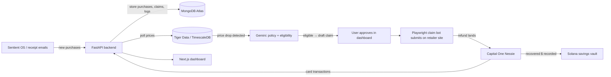

# Dropshot 🎯

> **Your purchases keep getting cheaper. Now so do you.**

Dropshot watches what you've bought, tracks the price afterward, and when the price drops inside the retailer's price-adjustment window, an AI agent works out whether you qualify and files the claim for you (after you approve it). The money it recovers lands in a savings vault on Solana.

## How it works



1. **Discover**: Sentient OS / receipt emails surface new purchases, and Nessie confirms the card charge.
2. **Watch**: workers poll the product's price and write every observation to Tiger Data.
3. **Decide**: on a drop, Gemini reads the retailer's policy and decides whether the purchase is eligible and for how much.
4. **Approve**: the user sees a drafted claim in the dashboard and taps approve.
5. **Claim**: the Playwright bot fills in and submits the retailer's price-adjustment form.
6. **Recover**: the refund deposit shows up in Nessie and gets recorded in the Solana savings vault.

## Repo layout and owners

| Layer | Folder | Owner | What it covers |
|---|---|---|---|
| 1. Frontend | [`frontend/`](frontend/LAYER.md) | _TBD_ | Next.js + TS, Tailwind, shadcn/ui, Recharts: dashboard, purchase cards, activity feed, savings charts |
| 2. Backend | [`backend/app/`](backend/app/LAYER.md) | _TBD_ | FastAPI endpoints, Redis + arq workers, scheduling, price monitoring, claim lifecycle |
| 3. AI and agents | [`backend/agents/`](backend/agents/LAYER.md) | _TBD_ | Gemini (receipts, policies, eligibility, explanations), Sentient OS, Playwright claim bot |
| 4. Database | [`backend/data/`](backend/data/LAYER.md) | _TBD_ | Tiger Data hypertables, MongoDB collections and indexes, seed data |
| 5. Financial | [`backend/finance/`](backend/finance/LAYER.md) + [`solana/`](solana/LAYER.md) | _TBD_ | Nessie sandbox banking, Solana + Anchor savings vault on devnet |
| 6. Deployment | [`infra/`](infra/LAYER.md) | _TBD_ | Docker images, Vultr hosting for API, workers and browser automation |

Shared contracts, which everyone should read before writing code:

- [`docs/api-contract.md`](docs/api-contract.md): REST endpoints between frontend and backend
- [`docs/data-model.md`](docs/data-model.md): Mongo collections and Timescale tables
- [`backend/app/models.py`](backend/app/models.py): Pydantic models (source of truth), mirrored in [`frontend/src/types/index.ts`](frontend/src/types/index.ts)
- [`docs/architecture.md`](docs/architecture.md): flow, boundaries and the demo script

> Fill in the owners above and in [`.github/CODEOWNERS`](.github/CODEOWNERS) once roles are assigned.

## Quick start

```bash
cp .env.example .env              # fill in keys (see comments inside)
docker compose up -d              # local Redis + TimescaleDB (+ optional local Mongo)

# Backend (Layers 2–5 share this Python project)
cd backend
python -m venv .venv && source .venv/bin/activate   # Windows: .venv\Scripts\activate
pip install -r requirements.txt
playwright install chromium
uvicorn app.main:app --reload     # http://localhost:8000/docs
arq app.workers.worker.WorkerSettings   # in a second terminal

# Frontend
cd frontend
npm install
npm run dev                       # http://localhost:3000
```

Until real integrations land, the API serves **mock data** (`MOCK_MODE=true`), so the frontend can be built in parallel from minute one.

## Team workflow

- Branch per layer or feature, for example `frontend/dashboard` or `agents/eligibility`. Open PRs into `main` and don't push to it directly.
- Change a shared contract (`models.py`, `api-contract.md`, `data-model.md`) **only** in its own small PR, and tell the team in the group chat.
- Every integration keeps a mock fallback behind `MOCK_MODE` so one broken API never blocks the demo.

## Tooling and sponsor tracks

- **Cursor** is the team's core AI coding agent. Claude Code is also used.
- **Gemini API**, **MongoDB Atlas**, **Tiger Data**, **Solana**, **Capital One Nessie**, **Sentient OS**, **Vultr**
- For the *Make it Legendary* raffle, the project description must explain how we use **Cursor** and a **Grok Bot** automation, and we must opt in at submission.
