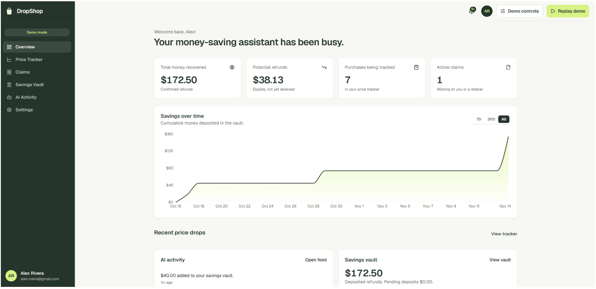
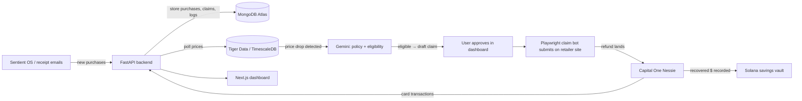

# DropShop 🎯

> **Your purchases keep getting cheaper. Now so do you.**


<p align="center">
  
</p>

<p align="center">
  <i>Your money-saving assistant has been busy.</i>
</p>

## An AI-powered price protection and savings platform. 

DropShop watches your purchases, tracks the prices of products, and when the price of a purchased product drops inside the retailer's price-adjustment window, an AI agent works out whether you qualify for a partial refund and files the claim for you (after your approval). The recovered money lands in a Solana savings vault.

## Features

- 🧾 **Purchase Watch:** Automatically identifies purchases through receipt emails and transaction data.
- 📉 **Price Monitoring:** Tracks product prices and detects price drops after purchases.
- 🤖 **AI Eligibility Analysis:** Uses Gemini to interpret retailer policies and evaluate potential refunds.
- ✅ **One-Click Approval:** Users review and approve claims before submission.
- 🌐 **Automated Claims:** Uses Playwright to assist with retailer price-adjustment submissions.
- 💰 **Savings Vault:** Tracks recovered savings through a Solana-powered vault.
- 📊 **Savings Dashboard:** Visualizes purchases, claims, and total money recovered.

## How it works



## Repo layout and owners

| Layer | Folder | Owner | What it covers |
|---|---|---|---|
| 1. Frontend | [`frontend/`](frontend/LAYER.md) | Aashita Singh | Next.js + TS, Tailwind, shadcn/ui, Recharts: dashboard, purchase cards, activity feed, savings charts |
| 2. Backend | [`backend/app/`](backend/app/LAYER.md) | Ishaan Jagali & Akshit Saraf | FastAPI endpoints, Redis + arq workers, scheduling, price monitoring, claim lifecycle |
| 3. AI and agents | [`backend/agents/`](backend/agents/LAYER.md) | Ishaan Jagali & Ayushi Biswas | Gemini (receipts, policies, eligibility, explanations), Sentient OS, Playwright claim bot |
| 4. Database | [`backend/data/`](backend/data/LAYER.md) | Ishaan Jagali | Tiger Data hypertables, MongoDB collections and indexes, seed data |
| 5. Financial | [`backend/finance/`](backend/finance/LAYER.md) + [`solana/`](solana/LAYER.md) | Akshit Saraf | Nessie sandbox banking, Solana + Anchor savings vault on devnet |
| 6. Deployment | [`infra/`](infra/LAYER.md) | TBD | Docker images, Vultr hosting for API, workers and browser automation |


## Quick start

```bash
cp .env.example .env              # fill in keys (see comments inside)
docker compose up -d              # local Redis + TimescaleDB (+ optional local Mongo)

# Backend (Layers 2–5 share this Python project)
cd backend
python -m venv .venv && source .venv/bin/activate   # Windows: .venv\Scripts\activate
pip install -r requirements.txt
playwright install chromium
uvicorn app.main:app --reload     # http://localhost:8000/docs
arq app.workers.worker.WorkerSettings   # in a second terminal

# Frontend
cd frontend
npm install
npm run dev                       # http://localhost:3000
```

Until real integrations land, the API serves **mock data** (`MOCK_MODE=true`), so the frontend can be built in parallel from minute one.

## Built With:

- **Cursor** is the team's core AI coding agent. **Claude Code** is also used.
- Gemini API, MongoDB Atlas, Tiger Data, Solana, Capital One Nessie, Sentient OS, Vultr
